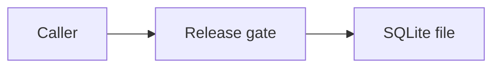

# Readylane

Release-gate service you can start on a host. A lead records an artifact digest, asks for release, and a different approver decides. SQLite keeps that decision across a process restart.

Customer cloud: **not used**. This repository does not deploy to a cloud account. The workstation proof is a process listening on `127.0.0.1`. The container proof is the GitHub Actions `image` job, which builds the image, runs the flow, removes the container, and starts a new one on the same database file.

The published ClaudeForge lab is unchanged.

## Run

Python 3.12. The process exits 2 when a token, subject, or database path is missing. Tokens are not written to the log.

```bash
python -m venv .venv
.venv/bin/pip install -e .
export READYLANE_LEAD_TOKEN=replace-lead-token
export READYLANE_LEAD_SUBJECT=SYN-USER-LEAD
export READYLANE_APPROVER_TOKEN=replace-approver-token
export READYLANE_APPROVER_SUBJECT=SYN-USER-APPROVER
export READYLANE_DB=readylane.sqlite
export READYLANE_HOST=127.0.0.1
export READYLANE_PORT=8080
.venv/bin/python -m readylane
```

On Windows use `.venv\Scripts\python.exe` and set the same variables in the shell. The two tokens must differ, the two subjects must differ, and each token must be at least 8 characters.

`GET /healthz` is open and reports `customer_cloud` `not-used`. `GET /readyz` checks SQLite. Changes use a bearer:

1. `POST /v1/changes` with the lead token.
2. `POST /v1/changes/{id}/verify` with `{"artifact":"..."}`. The service stores the SHA-256 and the byte length. It does not store the artifact text.
3. `POST /v1/changes/{id}/release` with the lead token.
4. `POST /v1/changes/{id}/decision` with `{"decision":"approve"}` or `reject` and the approver token.

The lead token receives 403 on the decision route. A rejected release stays rejected.

## Container

The image runs as uid 10001 and has no token baked in. Publish port 8080 only on localhost unless you intend to expose it. The database directory on a bind mount must be writable by uid 10001.

```bash
docker build -t readylane:ci .
bash scripts/container_smoke.sh
```

`scripts/container_smoke.sh` is what CI runs. The tokens inside that script are fixtures for the CI process.

## Checks

```bash
.venv/bin/pytest
.venv/bin/python benchmarks/run_live.py
```

## Evidence

`benchmarks/results/live_run.json` is the workstation run of `benchmarks/run_live.py`. On Windows-11-10.0.26200-SP0, processor Intel64 Family 6 Model 140 Stepping 1, GenuineIntel, cpu_count 8, Python 3.12.10, that script listened on 127.0.0.1, approved `CHG-1001`, stopped the process, started it again on the same SQLite file, and read `stage` `approved`. `persisted_after_restart` is true. The script wall clock, including both process starts, was 2926.5847 ms. That figure is not a per-request latency. The image build on this workstation is not-run. Customer cloud is not-used. The artifact digest recorded for `readylane-artifact-v1` is SHA-256 `f7ba495580e72b186b6f51bf25c2ef8670dca43059fbbd135ad24eebb3666f42`, 21 bytes.

| Check | Where it is proven |
| --- | --- |
| Process listens and completes a release | `benchmarks/run_live.py` on this machine |
| Restart reads the same approved row | the same script, second process, same SQLite file |
| Image build, replace, and read the volume | GitHub Actions job `image` |

## Architecture



## License

MIT. Copyright 2026 Jatinder Singh.
